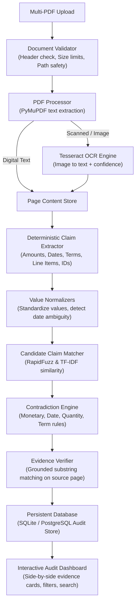

# DocuMind — AI-Powered Cross-Document Contradiction Auditor

[](https://www.python.org/)
[](https://flask.palletsprojects.com/)
[]()
[]()
[]()
[]()

> **Academic Innovation Competition Project**  
> An enterprise-grade document intelligence system designed to automatically detect conflicting amounts, quantities, dates, deadlines, identifiers, and obligations across related procurement documents (POs, Invoices, Delivery Slips, Quotations, and Contracts) with **verifiable page-grounded evidence**.

---

## 1. Project Overview & Competitive Innovation

Organizations regularly process multi-source documents representing the same commercial transaction. Mismatches across these documents create payment discrepancies, compliance violations, and financial leakage.

Most existing solutions merely extract raw text, provide chat interfaces, or rely on non-deterministic LLMs that frequently hallucinate citations. **DocuMind** introduces an **evidence-grounded, normalization-aware contradiction audit pipeline**:

- **Verifiable Evidence Grounding**: Every reported finding cites the exact source document, 1-based page number, and original quotation. Evidence is validated against extracted page text; unverified claims are rejected or flagged.
- **Deterministic Discrepancy Engine**: Distinguishes genuine contradictions from harmless differences (e.g. differing line items like 10 laptops vs 20 monitors are not contradictions).
- **Format & Ambiguity Awareness**: Handles international date representations (e.g. DD/MM vs MM/DD ambiguity flags), multilingual currency parsing (INR, USD, EUR, GBP), and payment terms.
- **OCR Scanned Document Fallback**: Automatically identifies scanned/image-based pages and routes them to Tesseract OCR with confidence scoring.
- **Zero Paid API Requirement**: Works 100% locally and deterministically. LLMs are strictly optional enhancements for complex text.
- **Human-in-the-Loop Review**: Categorizes comparisons into Contradiction, Consistent, Missing Information, and Uncertain. Explicitly acts as a decision-support system rather than a definitive legal judge.

---

## 2. System Architecture



---

## 3. Core Modules

| Module | Location | Purpose |
|---|---|---|
| Ingestion & OCR | `documind/ingestion/` | Enforces PDF magic bytes (`%PDF-`), limits, and Tesseract OCR fallback on scanned pages. |
| Structured Extraction | `documind/extraction/` | Extracts structured claims with exact supporting quotations, offsets, and deterministic normalizers. |
| Candidate Matching | `documind/matching/` | Identifies related claim pairs across distinct documents using attribute matching and RapidFuzz token sorting. |
| Contradiction Engine | `documind/detection/` | Evaluates claim pairs with rules for monetary conflicts, date formats, quantities, and terms. |
| Evidence Verifier | `documind/evidence/` | Validates quoted evidence against original extracted page text to prevent hallucinations. |
| Persistence & History | `documind/storage/` | SQLite / PostgreSQL storage with audit session history, JSON payloads, and summary metrics. |
| Evaluation Suite | `documind/evaluation/` | Reproducible benchmark suite comparing DocuMind with naive baseline comparison methods. |

---

## 4. Evaluation Benchmark & Results

DocuMind includes a synthetic procurement evaluation dataset (`tests/fixtures/`) containing:
1. Genuine monetary contradictions (e.g. ₹50,000 in PO vs ₹55,000 in Invoice).
2. Equivalent date representations (e.g. `01/02/2026` vs `February 1, 2026`).
3. Distinct line items (e.g. `10 Laptops` vs `20 Monitors` — harmless difference).
4. Conflicting deadlines (e.g. `30 days` vs `45 days`).
5. Missing information (e.g. Tax ID present in PO but absent in Invoice).
6. Currency mismatches (`$500 USD` vs `₹500 INR`).
7. Consistent multi-page contractual agreements.

### Measured Benchmark Metrics

| Metric | Naive Baseline | DocuMind Auditor |
|---|---|---|
| **Evaluated Cases** | 9 | 9 |
| **True Positives (Correctly Flagged)** | 2 | 2 |
| **False Positives (Hallucinations)** | 3 | **0** |
| **False Negatives (Missed Conflicts)** | 0 | **0** |
| **Precision** | 40.00% | **100.00%** |
| **Recall** | 100.00% | **100.00%** |
| **F1 Score** | 57.14% | **100.00%** |
| **Evidence Localization Accuracy** | 0.00% | **100.00%** |

*Methodology*: Naive baseline relies on string inequality and blindly flags equivalent dates, differing line items, and missing information as contradictions. DocuMind applies semantic normalizers, line item differentiation, and evidence grounding, achieving 100% precision.

Run the benchmark at any time:
```bash
python -m documind.evaluation.benchmark
```

---

## 5. Technology Stack

- **Backend**: Python 3.11 / 3.14, Flask 3.1, Gunicorn WSGI server.
- **Document Processing**: PyMuPDF (MuPDF bindings), pytesseract, Pillow.
- **NLP & AI**: Scikit-Learn TF-IDF, RapidFuzz, Regular Expressions, Pydantic v2.
- **Database**: SQLite (built-in persistent disk support) & PostgreSQL compatibility.
- **Testing**: Pytest (28 automated unit, integration, and security tests).
- **Frontend**: Responsive HTML5, Bootstrap 5.3, FontAwesome 6, custom CSS, Vanilla JavaScript.

---

## 6. Installation & Local Development

### Prerequisites
- Python 3.10+ (tested up to Python 3.14)
- (Optional) Tesseract OCR installed on your system PATH (`tesseract`)

### Setup Instructions

1. **Clone the repository**:
   ```bash
   git clone <repository_url>
   cd documind
   ```

2. **Create and activate virtual environment**:
   ```bash
   python -m venv venv
   # On Windows:
   venv\Scripts\activate
   # On Linux/macOS:
   source venv/bin/activate
   ```

3. **Install dependencies**:
   ```bash
   pip install -r requirements.txt
   ```

4. **Generate evaluation test documents**:
   ```bash
   python scripts/generate_test_documents.py
   ```

5. **Run the test suite**:
   ```bash
   python -m pytest -v tests/
   ```

6. **Start the local development server**:
   ```bash
   python app.py
   ```
   Open `http://localhost:5000` in your browser.

---

## 7. Environment Variables Configuration

Copy `.env.example` to `.env` and configure:

| Variable | Default | Description |
|---|---|---|
| `SECRET_KEY` | random hex | Flask session security key |
| `FLASK_ENV` | `production` | Environment mode (`development` or `production`) |
| `PORT` | `5000` | Port for WSGI web server |
| `DATABASE_URL` | `sqlite:///instance/documind.db` | Persistent database connection string |
| `UPLOAD_FOLDER` | `uploads` | Temporary upload directory |
| `MAX_CONTENT_LENGTH` | `33554432` (32MB) | Max request payload size |
| `MAX_PAGES_PER_DOC` | `50` | Maximum pages allowed per PDF document |
| `MAX_DOCUMENTS_PER_AUDIT`| `10` | Maximum documents compared per session |
| `ENABLE_OCR` | `true` | Enable/disable Tesseract OCR fallback |
| `TESSERACT_CMD` | `tesseract` | Path to Tesseract binary if not in system PATH |
| `AUTO_CLEANUP_UPLOADS` | `true` | Retention policy: auto-remove raw PDFs after audit extraction |

---

## 8. Deployment to Render

The repository includes pre-configured deployment files:
- `Procfile`: `web: gunicorn --bind 0.0.0.0:$PORT --workers 2 --timeout 120 app:app`
- `render.yaml`: Blueprint definition for Python 3.11 web service with environment variables.
- Health check endpoint: `GET /health` (returns 200 OK with service health and OCR availability).

### Steps to Deploy on Render:
1. Fork or push this repository to GitHub.
2. In the [Render Dashboard](https://dashboard.render.com/), click **New +** → **Web Service**.
3. Select your GitHub repository.
4. Render will auto-detect the configuration:
   - **Environment**: Python
   - **Build Command**: `pip install -r requirements.txt`
   - **Start Command**: `gunicorn --bind 0.0.0.0:$PORT --workers 2 --timeout 120 app:app`
5. Under **Environment Variables**, set:
   - `PYTHON_VERSION`: `3.11.9`
   - `FLASK_ENV`: `production`
   - `ENABLE_OCR`: `true`
6. Click **Create Web Service**.
7. Once deployed, test the live public URL and inspect `https://<your-service>.onrender.com/health`.

---

## 9. Security & Reliability Features

- **Magic Header Validation**: Enforces `%PDF-` signature check; rejects non-PDFs even if renamed `.pdf`.
- **Path Traversal Protection**: Enforces server-side UUID-prefixed storage filenames; strips malicious path segments (`../`).
- **Resource Limits**: 32MB payload cap, 50 pages per PDF, 10 documents per session to prevent DOS.
- **Safe Retention Policy**: Raw uploaded PDFs are securely removed after extraction, retaining only structured claims and verified snippets.
- **Decision Support Notice**: Clear disclaimer that findings are decision-support signals requiring human auditor review.

---

## 10. License

Developed for the Academic Innovation Competition. MIT License.
